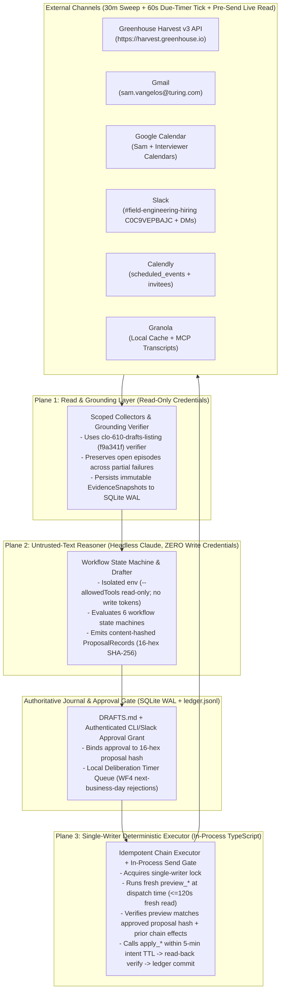
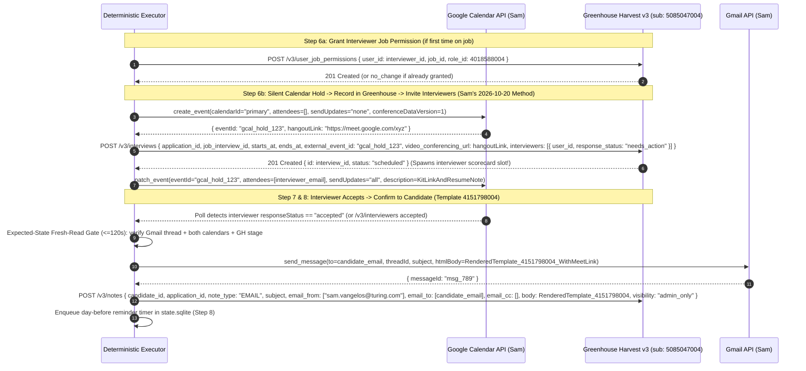

# Recruiting Operations Agent & `greenhouse-mcp` v2 — Principal Technical Specification (Rev 2: Post-Astra & Opus Review)

**Status:** Approved Architecture & Source of Truth (Rev 2 — Incorporates all P0/P1/P2 findings from parallel **Astra High** and **Opus High** reviews)  
**Owner:** Sam Vangelos (`greenhouse_user_id: 5085047004`, `referrer_id: 4838328004`, `sam.vangelos@turing.com`, Slack `U07RJJ6RLN6`)  
**Target Repositories:**
- [`greenhouse-mcp`](file:///Users/sam.vangelos/Projects/recruiting-tools/greenhouse-mcp) (`packages/scoped-core`, `packages/recruiter-mcp`, `packages/action-mcp`)
- [`scheduling-agent`](file:///Users/sam.vangelos/Projects/recruiting-tools/scheduling-agent)
- [`recruiting-agents`](file:///Users/sam.vangelos/Projects/recruiting-tools/recruiting-agents) ([`agents/desk`](file:///Users/sam.vangelos/Projects/recruiting-tools/recruiting-agents/agents/desk), [`agents/systems-admin`](file:///Users/sam.vangelos/Projects/recruiting-tools/recruiting-agents/agents/systems-admin))

---

## 1. Executive Summary & Architectural Doctrine

This specification defines the production architecture for evolving Sam Vangelos's scheduling pilot into a full-cycle **Recruiting Operations Agent**, alongside the required upgrades to [`greenhouse-mcp`](file:///Users/sam.vangelos/Projects/recruiting-tools/greenhouse-mcp) (`scoped-core`, `recruiter-mcp`, and `action-mcp`) so that every recurring workflow executes as a deterministic, idempotent API/MCP chain with **zero browser automation at runtime**.



### 1.1 Fixed System Invariants

1. **Single Human Identity (`5085047004`):** Every action runs as Sam Vangelos—his Gmail (`sam.vangelos@turing.com`), his Google Calendar, his Slack (`U07RJJ6RLN6`), and his Greenhouse user (`5085047004`, `referrer_id: 4838328004`, via Harvest v3 OAuth2 Bearer token with `sub: "5085047004"`). Every automated Greenhouse write records an audit note prefixed `"Per Sam Vangelos — assistant acted: ..."` (except where the Harvest endpoint itself writes an automatic `ACTIVITY` note, such as `POST /v3/applications/{id}/reject`).
2. **100% API/MCP Chained Runtime Execution (Zero Runtime Browser Automation):** Every runtime workflow—creating candidates, creating applications, uploading attachments, granting interviewer job access, scheduling interviews, sending candidate confirmations, submitting full rubric scorecards, moving stages within or across requisitions, and rejecting candidates with templated emails—executes through Harvest v3 REST endpoints and workspace MCP connectors. *(One-time manual UI setup exception: updating the master email template `4143188004` in `app4.greenhouse.io/email_templates` in **WP-0**, since Harvest v3 has no `PATCH /v3/email_templates` endpoint.)*
3. **Untrusted-Text Privilege Separation:** Any component that reads untrusted text (candidate emails, résumés, Calendly Q&A, Granola transcripts, non-Sam Slack messages) runs with **read-only tools and zero write credentials**, and can never set its own autonomy tier, fabricate an approval, or include `private_notes` in candidate-facing drafts. Plain deterministic TypeScript in the Executor owns all outward writes and enforces the send gate ([`.claude/hooks/send-gate.mjs`](file:///Users/sam.vangelos/Projects/recruiting-tools/scheduling-agent/.claude/hooks/send-gate.mjs)) in-process.
4. **Expected-State Fresh-Read Gate ($\le 120\text{s}$):** Immediately before any outward step, the Executor re-reads the relevant Gmail thread, calendars, Slack thread, and live Greenhouse state, and compares them against the **original approved state plus verified prior steps of the active chain** (excluding the chain's own calendar holds from conflict checks). If external state drifted, execution halts with `stale_proposal`.
5. **Single Authoritative Execution Journal + Backward-Compatible `ledger.jsonl`:** SQLite (`state.sqlite` in WAL mode) is the single transactional owner of episode state, authenticated approval grants, deliberation timers, and step claims under a single-writer lock. [`~/.recruiting-agents/scheduling-pilot/ledger.jsonl`](file:///Users/sam.vangelos/Projects/recruiting-tools/scheduling-agent/LEDGER.md) is maintained as an append-only, backward-compatible superset of v1 (`kind: "action" | "approval" | "wait" | "handoff"`) so existing readers ([`worker/ledger.mjs`](file:///Users/sam.vangelos/Projects/recruiting-tools/scheduling-agent/worker/ledger.mjs) and [`send-gate.mjs`](file:///Users/sam.vangelos/Projects/recruiting-tools/scheduling-agent/.claude/hooks/send-gate.mjs)) never break.
6. **Locked Product Rulings (2026-10-20):**
   - **Ruling 1 (Unmapped Calendly Bookings):** Never default an unmapped booking to job `5149015004`. Hold the Greenhouse candidate/application creation in `AWAITING_JOB_MAPPING` and ask Sam which requisition the candidate belongs to.
   - **Ruling 2 (Negative-Scorecard Deliberation Window):** Rejections triggered by a negative scorecard are held locally by the Executor until the **next business day (`Mon–Fri`, excluding US company holidays) between `10:00` and `15:00` in the candidate's local time zone** (fallback `America/Los_Angeles`), subject to **both** $\ge 18\text{ hours}$ wall-clock elapsed **and** $\ge 4\text{ working hours}$ (`09:00–17:00` local `Mon–Fri`) elapsed since the interview ended, plus deterministic minute jitter (`hash(application_id) % 47`).
   - **Ruling 3 (Emoji-Only Slack Approvals):** A `:thumbsup:` (`+1`) or `:white_check_mark:` reaction from an authorized Hiring Manager on a **single-candidate** presentation message by Sam in `#field-engineering-hiring` (`C0C9VEPBAJC`) or HM DM is treated as a positive signal to advance; multi-candidate slate posts require an explicit thread reply naming the candidate.
   - **Ruling 4 (Autonomous 24h Scorecard Chase):** The 24-working-hour overdue scorecard Slack DM nudge (`24h_scorecard_chase`) is promoted to the **Autonomous Exception Tier** and recorded in `JOB.md`.
   - **Ruling 5 (Post-Screen Rejection Master Template):** Update master Greenhouse email template `"0 - Rejection - Post Phone Interview"` (`id: 4143188004`) once in Greenhouse (`app4.greenhouse.io/email_templates`) and pass `email_template_id: 4143188004` to `POST /v3/applications/{id}/reject` at fire time.
   - **Ruling 6 (`JOB.md` Step 8 Candidate Confirmation API Chain):** Replace the legacy Greenhouse UI `"Send interview confirmation"` click in `JOB.md` Step 8 with the 100% API chain (`Chain A` Step 7): render confirmation template `4151798004` (`"Virtual Interview Confirmation *New*"`) with the Google Meet URL in place of the Zoom placeholder, patch the candidate onto the Google Calendar event (`sendUpdates: "all"`), send the confirmation email from `sam.vangelos@turing.com` on the active candidate Gmail thread, log the sent message onto the candidate's Greenhouse Activity Feed via `POST /v3/notes` (`note_type: "EMAIL"`), and schedule the day-before reminder.

### 1.2 Canonical Greenhouse & Slack Reference IDs (Verified Against [`req-1167-field-engineer.md`](file:///Users/sam.vangelos/Projects/recruiting-tools/recruiting-agents/docs/reference/reqs/req-1167-field-engineer.md) & [`people-and-ids.md`](file:///Users/sam.vangelos/Projects/recruiting-tools/recruiting-agents/docs/reference/people-and-ids.md))

> [!IMPORTANT]
> Dynamic per-job resolution (`search_my_job_interview_stages`, `search_my_job_interviews`, `search_my_interview_kits`) is always used at runtime for any requisition. For the pilot requisition (`5149015004`, *Field Engineer, AI Labs - US*, req `1167`), the verified IDs are:

| Entity | Verified ID | Notes |
|---|---|---|
| **Pilot Job (`Field Engineer, AI Labs - US`)** | `5149015004` | Status is **`draft`** (reopened). **Critical:** Harvest v3 returns `403` on 1-call `POST /v3/candidates` with a nested `application` when a job is in `draft` ([`req-1167-field-engineer.md:24`](file:///Users/sam.vangelos/Projects/recruiting-tools/recruiting-agents/docs/reference/reqs/req-1167-field-engineer.md#L24)). Always run `POST /v3/candidates` first, then `POST /v3/applications`. |
| **Sam Vangelos** | User `5085047004` | Referrer `4838328004`, Slack `U07RJJ6RLN6`, Email `sam.vangelos@turing.com`. |
| **Hiring Managers & Interviewers (`5149015004`)** | Andrew Ma `5313821004` (`zhengyuan.ma@turing.com`)<br>Robin Bordoli `5302802004`<br>Khiem Doan `5372540004` (`khiem.doan@turing.com`)<br>Melanie Tantingco `5320076004` | Andrew routes Field Engineer interviews to Khiem Doan (and Shyam Patel `shyam.patel@turing.com`). |
| **Slack Channel `#field-engineering-hiring`** | `C0C9VEPBAJC` | Primary presentation channel for `5149015004` (plus HM DMs). |
| **Stage 1: `Application Review`** | Stage `12579936004` | Job interview `14297387004`. |
| **Stage 2: `Recruiter Phone Screen`** | Stage `12579937004` | Job interview `14297388004` (*Preliminary Screening Call*, 30m), Kit `14297348004`. |
| **Stage 3: `Hiring Manager Review`** | Stage `12579938004` | Job interview `14297389004`. |
| **Stage 4: `Turing Assessment`** | Stage `12579939004` | Job interview `14297390004` (*Assessment*), Kit `14297350004`. |
| **Stage 5: `Manager / Tech Screen`** | Stage `12579940004` | Job interview `14297391004` (*Screening round*, 30m), Kit `14297351004`. |
| **Stage 6: `Onsite Interviews`** | Stage `12579941004` | SWE Domain `14559939004`, EKW `14559940004`, STEM `14559948004` (Kit `14559908004`), Research Partner & Sales `14559949004` (Kit `14559909004`), Assignment Presentation (Kit `14559899004`). |
| **Stages 7–9: Offer Stages** | Verbal `12579942004`, Extend `12579943004`, Signed `12579944004` | |
| **Sources & Roles** | Noon.ai `4042844004`<br>LinkedIn `4000133004`<br>Interviewer Role `4018588004` | `4018588004` is granted via `POST /v3/user_job_permissions` when placing a new interviewer on a job. |
| **Email Templates** | Confirmation: `4151798004`<br>Post-Screen Rejection: `4143188004` | `4151798004` = `"Virtual Interview Confirmation *New*"` (substitute Google Meet URL for Zoom). `4143188004` = `"0 - Rejection - Post Phone Interview"`. |

---

## 2. `greenhouse-mcp` Redesign Specification (`scoped-core`, `recruiter-mcp`, `action-mcp`)

### 2.1 Verified Root-Cause Matrix & Surgical Fixes

| ID | Package & Exact File Lines | Code-Grounded Root Cause | Exact Architectural Fix |
|---|---|---|---|
| **MCP-01** | [`packages/action-mcp/src/env.ts:145-163`](file:///Users/sam.vangelos/Projects/recruiting-tools/greenhouse-mcp/packages/action-mcp/src/env.ts#L145-L163) & Cloud Run deploy env | `interview_create` and `interview_update` are in `OPT_IN_ACTION_KINDS`, which [`scripts/verify-package.mjs:60-62`](file:///Users/sam.vangelos/Projects/recruiting-tools/greenhouse-mcp/packages/action-mcp/scripts/verify-package.mjs#L60-L62) and `interview-actions.test.ts:644-678` assert. In production, `GREENHOUSE_ACTION_CAPABILITIES` is set explicitly as an allowlist and omitted them. | Keep `OPT_IN_ACTION_KINDS` for unset-env safety tests; update the deployed `GREENHOUSE_ACTION_CAPABILITIES` allowlist and OAuth scopes (`harvest:interviews:create`, `harvest:interviews:update`, `harvest:interviews:destroy`, etc.) to enable all required actions. |
| **MCP-02** | [`packages/action-mcp/src/actions/interview-update.ts:45-48`](file:///Users/sam.vangelos/Projects/recruiting-tools/greenhouse-mcp/packages/action-mcp/src/actions/interview-update.ts#L45-L48) | `interview-update.ts` intentionally ignores `response_status` in `panelUserIds()` because Greenhouse mirrors calendar RSVPs onto `/v3/interviewers` (`0097:7`) and `PATCH /v3/interviews/{id}` replaces the entire `interviewers` array (`0100:7`). | **Do not PATCH interviews solely to flip RSVPs.** Keep `interview-update.ts`'s RSVP-tolerant panel comparison so unrelated RSVP movement between preview and apply never causes `STATE_CHANGED`. Read interviewer acceptance from Google Calendar + `/v3/interviewers`. |
| **MCP-03** | [`packages/action-mcp/src/actions/interview-create.ts:317-336`](file:///Users/sam.vangelos/Projects/recruiting-tools/greenhouse-mcp/packages/action-mcp/src/actions/interview-create.ts#L317-L336) | `current: { interviews: baseline }` and `approval.before.existing_interview_count` cover all interviews on the application, so creating/deleting another interview on the same application invalidates an open preview. | Narrow both `baseline` and `existing_interview_count` (renamed `existing_slot_interview_count` or filtered to `row.job_interview_id === input.job_interview_id || row.external_event_id === input.external_event_id`) to the target `job_interview_id`. |
| **MCP-04** | [`packages/action-mcp/src/actions/application-stage-move.ts:80-106`](file:///Users/sam.vangelos/Projects/recruiting-tools/greenhouse-mcp/packages/action-mcp/src/actions/application-stage-move.ts#L80-L106) | `application-stage-move.ts` derives `from_stage_id` from live state and validates that `to_stage_id` belongs to `application.jobId`; it has no `to_job_id` or `email_from_user_id`. | Keep `application_stage_move` for same-job moves (adding optional `email_from_user_id` and keeping live-derived `from_stage_id`), and add a dedicated single-request action **`application_job_transfer`** (`{ application_id, to_job_id, email_from_user_id? }`) fenced on both `{ kind: "application", id: application_id }` and `{ kind: "job", id: to_job_id }`. |
| **MCP-05** | [`packages/action-mcp/src/actions/application-rejection.ts:16-21,163-170`](file:///Users/sam.vangelos/Projects/recruiting-tools/greenhouse-mcp/packages/action-mcp/src/actions/application-rejection.ts#L16-L21) | Hardcodes `{ rejection_reason_id, notes }` and strips `rejection_email` and `custom_fields`. | Add optional `rejection_email: { email_template_id, email_from_user_id, send_email_at? }` and `custom_fields` to `application-rejection.ts`. Set `highImpact: true` when `rejection_email` is present, and update `effects`/`descriptions` dynamically. |
| **MCP-06** | [`packages/action-mcp/src/actions/candidate-note-create.ts:14`](file:///Users/sam.vangelos/Projects/recruiting-tools/greenhouse-mcp/packages/action-mcp/src/actions/candidate-note-create.ts#L14) & [`HARVEST-V3-API.md:74493`](file:///Users/sam.vangelos/Projects/recruiting-tools/ta-ops-analytics/docs/harvest-v3-api/HARVEST-V3-API.md#L74493) | `note_type: "EMAIL"` is excluded, and Harvest v3 requires `candidate_id`, `subject`, `email_from` (`string[]`), `email_to` (`string[]`), and `email_cc` (`string[]`) for `EMAIL` notes while forbidding them on `NOTE \| ACTIVITY`. | Expand `candidate-note-create.ts`, `CandidateNoteBinding` (`types.ts:82`), and `parseActionBinding` (`crypto.ts:189`) with a discriminated schema on `note_type`. Normalize `email_from`/`email_to` (array on write vs comma-separated string on read) in `normalized(row)` and desired fingerprinting. |
| **MCP-07** | [`packages/action-mcp/src/actions/index.ts`](file:///Users/sam.vangelos/Projects/recruiting-tools/greenhouse-mcp/packages/action-mcp/src/actions/index.ts), [`greenhouse.ts:10-24`](file:///Users/sam.vangelos/Projects/recruiting-tools/greenhouse-mcp/packages/action-mcp/src/greenhouse.ts#L10-L24), [`crypto.ts:156-235`](file:///Users/sam.vangelos/Projects/recruiting-tools/greenhouse-mcp/packages/action-mcp/src/crypto.ts#L156-L235), [`scripts/verify-package.mjs`](file:///Users/sam.vangelos/Projects/recruiting-tools/greenhouse-mcp/packages/action-mcp/scripts/verify-package.mjs) | Missing write actions for candidate create, application create, cross-job transfer, attachment create, prospect convert, candidate merge, interview delete, interviewer job-permission grant, and composite scorecard submit; `MUTATION_PATHS` in `greenhouse.ts` rejects their routes. | Add the 9 new `ActionKind`s, register all route regexes in `greenhouse.ts` (`MUTATION_PATHS`), extend `parseActionBinding()` in `crypto.ts`, add composite step support in `service.ts`, and update `verify-package.mjs`, `fence-structure.test.ts`, and `plane-parity.test.ts`. |
| **MCP-08** | [`packages/action-mcp/src/crypto.ts:52,271`](file:///Users/sam.vangelos/Projects/recruiting-tools/greenhouse-mcp/packages/action-mcp/src/crypto.ts#L52) & [`supabase/action-state.sql:143`](file:///Users/sam.vangelos/Projects/recruiting-tools/greenhouse-mcp/packages/action-mcp/supabase/action-state.sql#L143) | `INTENT_TTL_MS` is 5 minutes, enforced in `isExactIntent()` and SQL (`<= 6 minutes`), and bound to `sessionFingerprint`. | **Keep 5-minute session-bound action intents intact.** The Operations Agent persists Sam's approval against the 16-hex workflow proposal hash (`state.sqlite` + `ledger.jsonl`). At dispatch time, the Executor calls `preview_*` live, verifies `preview.approval` matches the approved proposal, and immediately calls `apply_*` in the same session. Add `"ops_executor"` to `ActionClient` (`types.ts:19` & `action-state.sql:69`). |
| **MCP-09** | [`packages/action-mcp/src/greenhouse.ts:221-230`](file:///Users/sam.vangelos/Projects/recruiting-tools/greenhouse-mcp/packages/action-mcp/src/greenhouse.ts#L221-L230) | Requires `GREENHOUSE_ACTION_ATTRIBUTION_MODE=per_human` and `GREENHOUSE_ACTION_PER_HUMAN_TOKEN_PROBE_PASSED=true`. | Keep the token-probe safety gate in code; run the probe and set both env vars in the local and Cloud Run configurations. |
| **MCP-10** | [`packages/recruiter-mcp/src/tools/evidence-projection.ts:798-809`](file:///Users/sam.vangelos/Projects/recruiting-tools/greenhouse-mcp/packages/recruiter-mcp/src/tools/evidence-projection.ts#L798-L809) | Sam's live profile resolves to `operator_site_admin` (`permissionScope.kind: "operator"`), which already restores `/v3/users.primary_email`, `emails`, `/v3/email_templates.recipients`, and admits `/v3/user_emails`. Non-operator profiles (`recruiter_default`) have them stripped by `GLOBAL_PII_FIELD_NAMES`. | Keep `recruiter_default` privacy tests intact; ensure Sam's identity (`5085047004`) always maps to the restore profile in both remote and local in-process runtimes. |
| **MCP-11** | [`packages/recruiter-mcp/src/tools/evidence-projection.ts:290-299,514-530,1036-1046`](file:///Users/sam.vangelos/Projects/recruiting-tools/greenhouse-mcp/packages/recruiter-mcp/src/tools/evidence-projection.ts#L1036-L1046) & [`packages/scoped-core/src/index.ts:3829-3831`](file:///Users/sam.vangelos/Projects/recruiting-tools/greenhouse-mcp/packages/scoped-core/src/index.ts#L3829-L3831) | 1. `private_notes` and `private_notes_with_tags` are in `GLOBAL_PII_FIELD_NAMES` and never re-added in `projectScorecardRow`.<br>2. Bridged scorecard reads stamp the whole scope's `jobIds` onto `_resolvedJobIds` (`evidence-read.ts:959-969`).<br>3. `scoped-core`'s `noteVisibilityAllowsScopedRead` (`S:3829`) drops all `admin_only_visible` and `privately_visible` notes on job-scoped reads before projection! | 1. Keep `/v3/scorecards` policy entries at `P:291-292`; in `projectScorecardRow` (`P:1036-1046`), re-add `private_notes` and `private_notes_with_tags` from the raw row when `row.status !== "draft"` and `isRowEntitledToPrivateData(row)` is true.<br>2. Stamp per-application `job_id` onto bridged rows in `evidence-read.ts`.<br>3. In `scoped-core` (`S:3829`), allow `admin_only_visible` notes on permitted jobs and `privately_visible` notes when `privateCapableJobIds.has(jobId)` or `operator`.<br>4. Restore `email_from`, `email_to`, `email_cc`, `email_attachment_file_names` in `projectNoteRow` under the note's visibility gate. |
| **MCP-12** | [`packages/scoped-core/src/index.ts:3147,3186`](file:///Users/sam.vangelos/Projects/recruiting-tools/greenhouse-mcp/packages/scoped-core/src/index.ts#L3147) & [`packages/recruiter-mcp/src/tools/evidence-read.ts:600-608,918`](file:///Users/sam.vangelos/Projects/recruiting-tools/greenhouse-mcp/packages/recruiter-mcp/src/tools/evidence-read.ts#L600-L608) | 1. In `scoped-core`, `filterNoteOrActivityRow` (`S:3147`) and `filterAttachmentRow` (`S:3186`) check `if ("application_id" in row)`. When v3 returns `application_id: null`, `"application_id" in row` is `true`, `readPositiveInteger(null)` is `null`, and the row is dropped as `missingParent()` before candidate fallback (`S:3161`) can run!<br>2. In `evidence-read.ts`, `/v3/notes` bridge drops `candidate_ids` and only queries `application_ids`. (Note: `/v3/attachments` in v3 requires non-nullable `application_id` per `HARVEST-V3-API.md:17566`, so dual-parent bridging applies to `/v3/notes`.) | 1. In `scoped-core` (`S:3147, 3186`), change `if ("application_id" in row)` to `if (row.application_id !== null && row.application_id !== undefined)`.<br>2. In `evidence-read.ts`, give `/v3/notes` a dual-parent bridge: derive both `application_ids` and `candidate_ids` in a single `/v3/applications` pass (`application-job-lookup.ts`), intersect explicit caller `candidate_ids`, fetch candidate-keyed notes (`application_id === null`) in a second pass, deduplicate by `id`, stable-sort by `id`, and reconcile row counts. |

---

### 2.2 Detailed Specifications for `action-mcp` Service Extensions & New Actions

#### 2.2.1 Resumable Composite-Action Execution in `GreenhouseActionService` (`service.ts`)
To support `scorecard_submit` (which executes multiple Harvest v3 calls: create/patch scorecard draft $\to$ create attribute ratings $\to$ create question answers $\to$ create answer-option links $\to$ finalize scorecard status to `"complete"`) without violating the single-`greenhouse.mutate()` call-site invariant in [`fence-structure.test.ts:133`](file:///Users/sam.vangelos/Projects/recruiting-tools/greenhouse-mcp/packages/recruiter-mcp/test/fence-structure.test.ts#L133):

1. **Extend `ActionDefinition` (`packages/action-mcp/src/actions/types.ts`):**
   - Keep `mutation?(value, prepared, context): Promise<MutationPlan>` for all single-request actions.
   - Add optional `nextCompositeStep?(value, prepared, context, stepHistory): Promise<{ done: true } | { done: false; stepKey: string; plan: MutationPlan; verifyStep: (response: GreenhouseMutationResponse | null, context: ActionContext) => Promise<{ status: "verified" | "not_observed" | "conflict"; resourceId?: number }> }>` for composite actions (`scorecard_submit`).
   - Add optional execution `payloadSchema?: z.ZodTypeAny` for actions carrying large out-of-band execution payloads (`attachment_create`) that are verified by SHA-256 digest in `prepareApply` and passed to `mutation(approval, prepared, context, payload)`.
2. **Single Service-Owned Loop (`packages/action-mcp/src/service.ts`):**
   - Inside `GreenhouseActionService.apply()`, if `definition.nextCompositeStep` is defined, `service.ts` loops (up to `MAX_COMPOSITE_STEPS = 40`):
     - Renews the action mutation lease (`extendLease(actionId, ownerToken, 120_000)` in `ActionStore` / `action-state.sql`).
     - Calls `definition.nextCompositeStep(...)` to inspect live state and compute the next unapplied step.
     - Persists the step claim (`stepKey`, `requestFingerprint`, `status: "executing"`) to `greenhouse_action_steps` (SQLite/Supabase store).
     - Calls the **single** `this.config.greenhouse.mutate({ ...step.plan, actorUserId: intent.actorUserId })` call site in `service.ts`!
     - Runs `step.verifyStep(...)` with read-back delays (`[0, 2_000, 3_000]`). If a step fails or conflicts mid-flight, `service.ts` records `status: "failed"`, `errorCode: "PARTIAL_APPLIED"`, and releases the target lock so a fresh `preview_scorecard_submit` can inspect live state and resume only the remaining unapplied rows.

#### 2.2.2 `candidate_create` (`POST /v3/candidates` — Person Record Only)
- **Why Person-Only (No Nested Application):** Pilot job `5149015004` (and any `draft` job in Greenhouse) returns `403` when `POST /v3/candidates` includes a nested `application` ([`req-1167-field-engineer.md:24`](file:///Users/sam.vangelos/Projects/recruiting-tools/recruiting-agents/docs/reference/reqs/req-1167-field-engineer.md#L24)). Separating `candidate_create` (`POST /v3/candidates`) and `application_create` (`POST /v3/applications`) works on **both** `draft` and `open` jobs and keeps each action a clean single-resource mutation.
- **Fence & Lock Key:**
  - Requires `context_job_id: id` in `previewSchema` to fence visibility on `{ kind: "job", id: input.context_job_id, requiresUnredacted: false }` and `assertJobAccess(input.context_job_id, context)`.
  - Uses lock key `candidate-email:<hmac_sha256(primary_email)>` (extending `LOCK_KEY_PATTERN` in [`crypto.ts:23`](file:///Users/sam.vangelos/Projects/recruiting-tools/greenhouse-mcp/packages/action-mcp/src/crypto.ts#L23) and [`action-state.sql:62`](file:///Users/sam.vangelos/Projects/recruiting-tools/greenhouse-mcp/packages/action-mcp/supabase/action-state.sql#L62) to accept `^(?:application|candidate|job|offer):[1-9][0-9]*$|^candidate-email:[0-9a-f]{64}$`).
- **Duplicate Check & Privacy Fence:**
  - Queries `GET /v3/candidates?email=<email>` in **both** `preparePreview` and `prepareApply` (under the `candidate-email` lock).
  - If a candidate already exists: checks visibility via `context.visibility({ kind: "candidate", id: matchedId, requiresUnredacted: false })`. Never discloses unpermitted candidate IDs; if visible, returns `changeRequired: false` with the existing `candidate_id` in `preview.existing_candidate_id` so the caller proceeds directly to `application_create`.
- **Response ID Extraction:** `POST /v3/candidates` returns `{ candidate: { id, ... }, application: null }` (or top-level `{ id }` when no `application` key is sent; `resultResourceId` handles both `body.candidate?.id ?? body.id`).

#### 2.2.3 `application_create` (`POST /v3/applications`)
- **Input:** `{ candidate_id, job_id, initial_stage_id?, source_id?, referrer_id?, recruiter_id?, coordinator_id?, custom_fields? }`.
- **Fences & Lock Key:**
  - Fences on `[{ kind: "candidate", id: candidate_id, requiresUnredacted: false }, { kind: "job", id: job_id, requiresUnredacted: false }]`.
  - Lock key: `candidate:${candidate_id}`.
- **Preflight & Read-Back:**
  - Queries `/v3/applications?candidate_ids=${candidate_id}&job_ids=${job_id}`. If an active application already exists on `job_id`, returns `changeRequired: false`.
  - If `custom_fields` are provided, extends `validateCustomFields()` in [`custom-fields.ts`](file:///Users/sam.vangelos/Projects/recruiting-tools/greenhouse-mcp/packages/action-mcp/src/custom-fields.ts) to support `fieldType: "application"`.

#### 2.2.4 `application_job_transfer` (`POST /v3/applications/{id}/move` with `to_job_id`)
- **Input:** `{ application_id: id, to_job_id: id, email_from_user_id: id.optional() }`.
- **Preflight:**
  - Derives `from_stage_id` from the live application's `stage_id` (matching `application-stage-move.ts:96-99`).
  - Fences on `[{ kind: "application", id: application_id, requiresUnredacted: false }, { kind: "job", id: to_job_id, requiresUnredacted: false }]`.
  - Queries `/v3/job_interview_stages?job_ids=${to_job_id}` to record the destination job's first active stage ID in `JobTransferBinding` for read-back verification (`observe()`).

#### 2.2.5 `attachment_create` (`POST /v3/attachments`)
- **Preview Input:** `{ application_id: id, filename: string, type: AttachmentType, visibility?: "public" | "admin_only" | "private", content_sha256: string, byte_length: number }`.
- **Apply Input:** `{ intent: string, approval: Approval, payload: { content: string } }` (where `payload.content` is standard base64).
- **Verification & Wire Contract:**
  - In `prepareApply(approval, context, payload)`: strictly decodes `payload.content` from base64 into a `Buffer`, verifies `buffer.byteLength === binding.byte_length` ($\le 10\text{ MB}$) and `sha256(buffer) === binding.content_sha256`.
  - Sends wire body `{ application_id, filename, type, content: payload.content, ...(visibility ? { visibility } : {}) }` (`content` is the exact Harvest v3 property name per `HARVEST-V3-API.md:0036:487`).
  - `url` uploads are deliberately excluded so untrusted URLs are never fetched server-side by Greenhouse without byte-exact digest verification.
  - `effects` discloses: *"Uploading a resume or cover_letter reclassifies any existing attachment of that type on the application as 'other'."*
  - Invoked in-process by the Executor via `GreenhouseActionService` (bypassing the 262,144-byte HTTP transport cap in [`http-request.ts:3`](file:///Users/sam.vangelos/Projects/recruiting-tools/greenhouse-mcp/packages/recruiter-mcp/src/http-request.ts#L3)).

#### 2.2.6 `prospect_convert` (`POST /v3/applications/{id}/convert_to_candidate`)
- **Input:** `{ prospect_application_id: id, job_id: id, to_job_interview_stage_id: id.optional() }`.
- **Critical Response Contract (`HARVEST-V3-API.md:6667`):** Converting a prospect transitions `prospect_application_id` to `status: "converted"` and returns a **new candidate application** with a new `id` in the `200`/`201` response body (`resultResourceId: createdResourceId`). `observe()` checks that the old application is `converted` and a new candidate application (`prospect: false`) exists on `job_id`. All downstream workflow steps switch to the newly returned `application_id`.

#### 2.2.7 `user_job_permission_create` (`POST /v3/user_job_permissions`)
- **Purpose:** Required by [`JOB.md` Step 6](file:///Users/sam.vangelos/Projects/recruiting-tools/scheduling-agent/JOB.md#L31) (*"A new interviewer is first granted the Interviewer role on the job in Greenhouse so the kit link resolves without a permission error"*).
- **Input:** `{ user_id: id, job_id: id, role_id: z.literal(4018588004) }` (locked to the `"Interviewer"` role `4018588004` unless `highImpact` admin override).
- **Fence:** `{ kind: "job", id: job_id, requiresUnredacted: false }` + `assertActiveUser(user_id, context)`.
- **Preflight & Read-Back:** Queries `/v3/user_job_permissions?job_ids=${job_id}&user_ids=${user_id}`. If the grant already exists, returns `changeRequired: false`.

#### 2.2.8 `interview_delete` (`DELETE /v3/interviews/{id}`)
- **Input:** `{ interview_id: id, application_id: id }`.
- **Safety Gate:** Preflight reads `/v3/interviews?ids=${interview_id}`. Refuses deletion unless `status === "scheduled"` (never deletes `awaiting_feedback` or `complete` interviews where an interviewer may have an in-progress scorecard, per `HARVEST-V3-API.md:0098:7`). Used **only** for true interview cancellations before the interview starts; reschedules always use `interview_update` (`PATCH /v3/interviews/{id}`).

#### 2.2.9 `scorecard_submit` (Composite Scorecard Orchestrator)
- **Lifecycle & Safety Rules:**
  1. **Actor Lock:** `interviewer_id` and `submitter_id` are strictly locked to `context.actorUserId` (`5085047004`). The tool cannot submit a scorecard in another interviewer's name.
  2. **Rubric & Schema Validation (`prepare`):**
     - Reads `/v3/interview_kits?ids=${interview_kit_id}`, `/v3/scorecard_questions?interview_kit_id=${interview_kit_id}`, `/v3/scorecard_question_options`, and `/v3/job_candidate_attributes?job_ids=${job_id}`.
     - Validates every `scorecard_question_id` belongs to `interview_kit_id`, every `option_id` belongs to its `scorecard_question_id`, every `job_candidate_attribute_id` belongs to `job_id`, required questions are answered, and `yes_no` questions supply `boolean_value: boolean` (`HARVEST-V3-API.md:0156:595`).
     - Bounds `notes` and `private_notes` to `max(90_000)` chars so read-back never hits the `100_000`-char projection truncation ceiling (`evidence-projection.ts:36`).
  3. **Conflict Detection Against Existing Scorecards:**
     - Queries `/v3/scorecards?application_ids=${application_id}`, `/v3/scorecard_candidate_attributes`, `/v3/scorecard_question_answers`, and `/v3/scorecard_question_answer_options`.
     - If a `complete` scorecard already exists for `(application_id, interview_kit_id, actorUserId)`, or if a human-edited `draft` has non-empty notes/ratings/answers that differ from the approved payload, aborts with `CONFLICT` (never overwrites human work or reopens a completed scorecard).
  4. **Step Progression (`nextCompositeStep`):**
     - **Step 1 (`header_draft`):** `POST /v3/scorecards` with `status: "draft"` (never `"complete"` on initial creation, preventing WF4 from firing on a half-populated scorecard).
     - **Step 2..N (`attr:<job_candidate_attribute_id>`):** `POST /v3/scorecard_candidate_attributes` for each unrecorded attribute rating.
     - **Step N+1..M (`ans:<scorecard_question_id>`):** `POST /v3/scorecard_question_answers` (passing `answer` or `boolean_value`), recording the returned `scorecard_question_answer_id`.
     - **Step M+1..K (`opt:<scorecard_question_id>:<option_id>`):** `POST /v3/scorecard_question_answer_options` linking `{ scorecard_question_answer_id, scorecard_question_option_id }`.
     - **Step Final (`header_complete`):** Once all attributes, answers, and option links are verified on read-back, sends `PATCH /v3/scorecards/${scorecard_id}` with `{ status: "complete" }` (if requested final status is `"complete"`).

---

## 3. Canonical Chained API Execution Flows

### 3.1 Chain A: End-to-End Interview Scheduling & Confirmation (Workflow 6 / `JOB.md` Steps 1–10)



> [!IMPORTANT]
> **Why Silent Hold $\to$ `POST /v3/interviews` $\to$ Add Guests (Sam's 2026-10-20 Method):**
> Creating the Google Calendar event silently (`attendees: []`, `sendUpdates: "none"`) first gives us a deterministic `external_event_id` and `hangoutLink`. If `POST /v3/interviews` fails for any reason, we delete the silent calendar event immediately and **no interviewer ever receives an orphan calendar invite for an unrecorded interview**. Only after `POST /v3/interviews` succeeds do we patch the calendar event to invite the interviewer(s) with the Greenhouse interview kit URL (`https://app4.greenhouse.io/guides/{interview_kit_id}/people/{candidate_id}?application_id={application_id}`).

### 3.2 Chain B: Locally Held Deliberated Rejection + Templated Email (Workflow 4)

1. **Why the Timer Must Stay Local Until Fire Time:**
   - Calling `POST /v3/applications/{id}/reject` with a future `send_email_at` immediately marks the application `rejected` in Greenhouse, writes an `ACTIVITY` rejection note immediately, and queues the email inside Greenhouse with no Harvest v3 endpoint to cancel just the queued email if a late positive scorecard or HM override arrives.
   - Therefore, the Executor holds the deliberation timer **locally in `state.sqlite` (`deliberation_timers` table)** while the application remains `in_process`.
2. **Unified Deliberation Window Formula (Ruling 2):**
   - Given `interview_ended_at` (UTC) and `candidate_tz` (mapped from Greenhouse's Rails-style `time_zone` string via `RAILS_TO_IANA_TZ` in `src/utils/timezone.ts`, fallback `America/Los_Angeles`):
     1. `t_wall = interview_ended_at + 18 hours`
     2. `t_work = add_working_hours(interview_ended_at, 4 hours, candidate_tz)` (counting `09:00–17:00 Mon–Fri`, excluding US company holidays)
     3. `t_next_day = start_of_next_calendar_day(interview_ended_at, candidate_tz)`
     4. `t_floor = max(t_wall, t_work, t_next_day)`
     5. Advance `d` to the first business day (`Mon–Fri`, non-holiday) in `candidate_tz` where `d_14:13_local >= t_floor`.
     6. `base_time = max(t_floor, d_10:00_local)`
     7. `fire_at = base_time + (sha256_uint32(String(application_id)) % 47) minutes` (guaranteed within `[10:00, 15:00]` local time because `base_time <= 14:13_local`).
   - **Missed-Window Guard (Sleeping Mac / Offline Recovery):** If the Executor wakes up after `d_15:00_local`, it **never** fires a rejection email at night or outside `[10:00, 15:00]` local time; it advances `fire_at` to `10:00 + jitter` on the next business day in `candidate_tz`.
   - **Approval Lifetime for Delayed Work:** A human approval of a WF4 deliberated rejection Proposal explicitly authorizes execution at the proposal's computed `fire_at` window (up to 96 hours across a weekend) provided the pre-fire check passes.
3. **Fire-Time Execution:**
   - At `now >= fire_at` (within `[10:00, 15:00]` candidate local time), the Executor runs a live fresh read of `/v3/applications/{id}`, `/v3/scorecards`, Slack `#field-engineering-hiring` (`C0C9VEPBAJC`) + HM DMs, and Gmail.
   - If any positive scorecard, stage advance, HM override, or candidate withdrawal occurred since the negative scorecard, the timer transitions to `ABORTED_STATE_CHANGED` and alerts Sam.
   - Otherwise, executes `preview_application_rejection` + `apply_application_rejection` (`POST /v3/applications/{id}/reject`) with:
     ```json
     {
       "rejection_reason_id": 50000123,
       "notes": "Per Sam Vangelos — assistant acted: Rejected following negative interview scorecard.",
       "rejection_email": {
         "email_template_id": 4143188004,
         "email_from_user_id": 5085047004
       }
     }
     ```
   - *(No separate `POST /v3/notes` call is made after `reject`, because `POST /v3/applications/{id}/reject` natively creates the Greenhouse `ACTIVITY` rejection note with `notes`.)*

### 3.3 Chain C: Candidate Intake & Two-Step Upload (Workflow 1)
1. **Step 1 (`candidate_create` or Lookup):** If candidate does not exist by email/LinkedIn slug, run `POST /v3/candidates` (person record only, with `first_name`, `last_name`, `email_addresses`, `phone_numbers`, `social_media_addresses`, `tags`). Capture `candidate_id`.
2. **Step 2 (`application_create` or `prospect_convert`):**
   - If no application exists on the target `job_id`: run `POST /v3/applications` (`{ candidate_id, job_id, initial_stage_id, source_id, referrer_id: 4838328004, recruiter_id: 5085047004, coordinator_id: 5085047004 }`). Capture `application_id`.
   - If a prospect application exists on `job_id`: run `POST /v3/applications/{prospect_app_id}/convert_to_candidate` (`{ job_id, to_job_interview_stage_id: initial_stage_id }`). Capture the **newly returned `application_id`**.
   - If an active application exists in `Application Review`: run `POST /v3/applications/{id}/move` to `Recruiter Phone Screen` (`12579937004` on `5149015004`, or dynamically resolved per job).
3. **Step 3 (`attachment_create`):** If résumé bytes were collected and no résumé attachment exists on `application_id`, run `POST /v3/attachments` (`{ application_id, filename, type: "resume", content: base64 }`).
4. **Step 4 (`interview_create`):** Link the Calendly Google Calendar event (`external_event_id`) to the job's `Recruiter Phone Screen` interview slot (`14297388004` on `5149015004`) via `POST /v3/interviews` so Sam's scorecard slot is ready.

### 3.4 Chain D: Recruiter Screen Scorecard Submission + Coupled Next Step (Workflow 2)
1. **Step 1 (`scorecard_submit`):** Composite action creates draft scorecard (`POST /v3/scorecards` on kit `14297348004` for `5149015004`, or dynamically resolved kit for the job), populates attribute ratings (`POST /v3/scorecard_candidate_attributes`), populates question answers (`POST /v3/scorecard_question_answers` + `POST /v3/scorecard_question_answer_options`), and finalizes `PATCH /v3/scorecards/{id}` `{ status: "complete" }`.
2. **Step 2 (Coupled Decision — Resumable Independently of Trigger):**
   - Persisted as a linked step on the same chain in `state.sqlite` so that once Step 1 completes (making "no completed scorecard" false on the next scan), Step 2 **still runs to completion**:
   - **Advance branch (`yes` / `strong_yes`):** `POST /v3/applications/{id}/move` (`12579937004` $\to$ `12579938004` `Hiring Manager Review`) $\to$ Slack presentation post in `#field-engineering-hiring` (`C0C9VEPBAJC`).
   - **Reject branch (`no` / `strong_no`):** Enqueues Chain B deliberated rejection timer in `state.sqlite`.

### 3.5 Chain E: Cross-Requisition Transfer or Fork (Workflow 5A)
- **Mutually Exclusive Mode (`transfer` vs `fork`):**
  - **Mode 1 (`transfer` — move application off source job onto destination job):**
    1. `application_job_transfer`: `POST /v3/applications/{id}/move` `{ from_stage_id, to_job_id, email_from_user_id: 5085047004 }`. (Lands on destination job's first stage.)
    2. If target stage on `to_job_id` is deeper than stage 1: `application_stage_move` `POST /v3/applications/{id}/move` `{ from_stage_id: dest_stage_1, to_stage_id: dest_target_stage_id }`.
    3. `candidate_note_create` audit note.
  - **Mode 2 (`fork` — keep application active on both requisitions):**
    1. `application_create`: `POST /v3/applications` `{ candidate_id, job_id: to_job_id, initial_stage_id: dest_target_stage_id, source_id, referrer_id: 4838328004, recruiter_id: 5085047004 }`.
    2. Copy latest resume attachment to the new `application_id` via `attachment_create`.
    3. `candidate_note_create` audit note.

---

## 4. Complete Workflow State Machine Rules & Exit Transitions

### 4.1 Workflow 1: Candidate Books Time with Sam
- **Primary Episode Identity:** Keyed by Calendly `invitee_uri` (when present) or Google Calendar `iCalUID` / `event.id`, with `booking_fingerprint = sha256(normalize_email(email) + "|" + round_to_5min(starts_at))` used only to correlate the 3 signals (Calendly API, Gmail confirmation, Google Calendar event) into the same episode.
- **Reschedule / Cancellation Handling:** If a Calendly booking is rescheduled or cancelled (`status: "canceled"` or calendar event moved), updates the existing `IntakeEpisode` in place rather than spawning a second episode.
- **Hold Exit Transitions (`AWAITING_JOB_MAPPING`):**
  - Surfaces a high-priority question in `DRAFTS.md` and Slack DM to Sam.
  - If Sam has not mapped the job by `starts_at - 2 hours`, sends a single urgent Slack DM reminder to Sam.
  - Even while an episode is in `AWAITING_JOB_MAPPING`, **Workflow 2 still captures and drafts the Granola screen notes** after the call ends (holding only the Greenhouse `scorecard_submit` until Sam supplies the `job_id`, which immediately unlocks both Chain C and Chain D!).

### 4.2 Workflow 2: Sam Finishes a Recruiter Screen (Granola $\to$ Scorecard)
- **Strict Rating Authority ([`agents/systems-admin/WORKFLOW.md:9`](file:///Users/sam.vangelos/Projects/recruiting-tools/recruiting-agents/agents/systems-admin/WORKFLOW.md#L9)):**
  - Overall `candidate_rating` (`strong_yes | yes | no | strong_no`) and attribute ratings are taken **only from Sam's explicit assessment in his notes/transcript or Slack instruction**; unsupported attributes are omitted rather than guessed by the model.
  - Every statement in `notes` (Key Take-Aways) and `question_answers` must carry a verbatim quote from the Granola transcript or Sam's notes.
- **Field Mapping Adapter (`systems-admin` $\to$ `scorecard_submit`):**
  - `draft.key_takeaways` $\to$ `scorecard_submit.notes`
  - `draft.overall_recommendation` $\to$ `scorecard_submit.candidate_rating`
  - `draft.attributes[].id / value / note` $\to$ `scorecard_submit.attribute_ratings[].{ job_candidate_attribute_id, candidate_attribute_rating, note }`
  - `draft.questions[].id / text / boolean_value / option_ids` $\to$ `scorecard_submit.question_answers[]`
- **Hold Exit Transitions (`AWAITING_MANUAL_NOTES`):**
  - If no Granola transcript appears by `ends_at + 95m`, prompts Sam once in `DRAFTS.md` / Slack. Expires to `CLOSED_MANUAL` after 5 business days or if a scorecard is submitted manually in Greenhouse.

### 4.3 Workflow 3: Hiring Team Positive Signal in Slack ($\to$ Next Stage & Action)
- **Signal Consumption Key:** `hm_signal:{channel_id}:{message_ts}:{reactor_or_reply_id}:{application_id}:{stage_id}`. Consumed **once** per `(application_id, stage_id)` so a persistent `:thumbsup:` reaction never advances the candidate a second time after the stage move succeeds!
- **Reaction Removal / Message Edit Check:** During the $\le 120\text{s}$ pre-dispatch fresh read, the Executor re-reads the Slack message reactions and thread replies; if the reaction was removed or a conflicting reply was posted, the proposal aborts with `stale_proposal`.
- **Dynamic Next-Stage Routing:**
  - Reads the job's ordered stages from `/v3/job_interview_stages`.
  - On `5149015004`, the stage after `Hiring Manager Review` (`12579938004`) is `Turing Assessment` (`12579939004`) or `Manager / Tech Screen` (`12579940004`) depending on whether the HM requests the take-home assessment or direct tech screen with Khiem Doan (`5372540004`).
  - Checks whether the target stage has an automated Greenhouse stage-transition email rule configured before drafting a separate Gmail outreach message so the candidate is never double-emailed.

### 4.4 Workflow 4: Negative Scorecard Submitted ($\to$ Deliberated Rejection)
- **Trigger Scoping:** Bound to `(application_id, current_stage_id, scorecard_id)`. An old negative scorecard from an earlier stage (where Sam previously overrode and advanced the candidate) is ignored.
- **Hold Exit Transitions (`CONFLICT_HOLD`):**
  - When a panel stage has mixed ratings (`yes` + `no`), holds in `CONFLICT_HOLD` and asks Sam for a debrief ruling. Once Sam approves either "Advance" or "Reject", records the resolution keyed to `scorecard_ids_hash` so the same scorecard set never re-triggers `CONFLICT_HOLD`.

### 4.5 Workflow 5: Greenhouse Grooming & Hygiene
- **5A (Cross-Job Transfer / Fork):** Uses Chain E (`application_job_transfer` or `application_create`).
- **5B (Stage Drift Repair):** Only proposes forward stage repair when a **current** `scheduled` or `awaiting_feedback` interview exists for a later stage $S_k$ (`rank(S_k) > rank(current_stage)`). Never moves an application backward based on historical completed interviews.
- **5C (Missing Recruiter / Coordinator Assignment):** Uses the existing `application_assignment_change` tool in `action-mcp` (`preview_application_assignment_change` / `apply_application_assignment_change`), **not** an unbuilt `PATCH /v3/applications/{id}` call.

### 4.6 Workflow 6: Full 10-Step Scheduling Lifecycle ([`JOB.md`](file:///Users/sam.vangelos/Projects/recruiting-tools/scheduling-agent/JOB.md))
Preserves all 10 steps of `JOB.md` and keeps [`tools/render.mjs`](file:///Users/sam.vangelos/Projects/recruiting-tools/scheduling-agent/tools/render.mjs) compatible:
- **Step 1:** Spot HM's yes (in `#field-engineering-hiring` `C0C9VEPBAJC` or HM DM) $\to$ move to target interview stage.
- **Step 2:** Ask candidate for availability (24-working-hour nudge, 48-working-hour escalation to Sam).
- **Step 3:** Parse candidate's availability windows in candidate's time zone.
- **Step 4:** Find overlapping slot on designated interviewer's calendar (for `5149015004`: Khiem Doan `5372540004` / `khiem.doan@turing.com`).
- **Step 5:** Offer interviewer's 3 earliest open slots when no overlap exists.
- **Step 6:** Grant Interviewer role (`4018588004`) via `user_job_permission_create` if needed $\to$ create silent Google Calendar hold $\to$ `POST /v3/interviews` $\to$ patch calendar hold with interviewer & kit link.
- **Step 7:** Wait for interviewer acceptance; chase on Slack at `+12 working hours`, follow up at `+24 working hours`, escalate to HM at `+48 working hours`. On decline, read interviewer's Slack DM + email (unfiltered by subject) before rebooking.
- **Step 8:** Send standard confirmation (`4151798004` with Google Meet link) via Gmail, log `EMAIL` note in Greenhouse, and schedule day-before reminder.
- **Step 9:** Monitor until interview; handle reschedules via `PATCH /v3/interviews/{id}` (`interview_update`) + Google Calendar `patch_event` (resetting interviewer acceptance check and incrementing timer attempt counter `attempt` in `chase24h:{interview_id}:{user_id}:{attempt}`), and true cancellations via `DELETE /v3/interviews/{id}` (`interview_delete`) + immediate candidate notification on urgent cancellation.
- **Step 10:** Live interview-day monitoring (1-hour pre-check + live call-waiting nudges). Post-interview scorecard chasing (`+2 working hours` reminder proposal, `+24 working hours` autonomous Slack DM chase per Ruling 4, cancelled immediately once scorecard `status === "complete"`) bridges Step 10 into `systems-admin` / Workflow 2 & 4.

---

## 5. Storage, Single-Writer Journal & Backward-Compatible Ledger

### 5.1 Authoritative SQLite Store + Legacy `ledger.jsonl` Compatibility
1. **Keep Existing Ledger Path (`~/.recruiting-agents/scheduling-pilot/ledger.jsonl`):**
   - Every outward action continues to write standard v1 records (`kind: "action"`, `status: "intent" | "dispatched" | "failed"`, `action_key`, `episode_id`, `idempotency_key`, `exception`, `at`, `provider_id`) so [`worker/ledger.mjs`](file:///Users/sam.vangelos/Projects/recruiting-tools/scheduling-agent/worker/ledger.mjs) and [`.claude/hooks/send-gate.mjs`](file:///Users/sam.vangelos/Projects/recruiting-tools/scheduling-agent/.claude/hooks/send-gate.mjs) continue working with zero breakage.
   - **Fix `worker/ledger.mjs:169-170`:** Update `dischargedKeys()` so only `status: "dispatched"` (or `"succeeded"` / `"reconciled"`) counts as discharged work; a crashed `status: "intent"` with no matching `dispatched` record surfaces as `unresolved_intent` requiring reconciliation before retry.
2. **Authoritative SQLite Coordinator (`~/.recruiting-agents/scheduling-pilot/state.sqlite`):**
   - Owns the single-writer execution lock (`BEGIN IMMEDIATE`), multi-step chain state (`chain_steps`), authenticated approval grants (`approvals`, keyed to 16-hex SHA-256 `proposal_hash` matching [`agents/desk`](file:///Users/sam.vangelos/Projects/recruiting-tools/recruiting-agents/agents/desk)), and local deliberation/reminder timers (`timers`).
   - Separates **30-minute channel collection cadence** (`worker/pilot.mjs`) from **60-second due-timer & approved-queue execution** (`worker/executor-tick.mjs`), so approved actions and due deliberation timers (`fire_at`) execute with minute-level precision without running an expensive LLM sweep.

---

## 6. Phased Implementation Plan & Work Packages (Revised Order)

### WP-0: One-Time Master Rejection Template Update & `per_human` Token Probe
- Update master template `4143188004` (`"0 - Rejection - Post Phone Interview"`) in `app4.greenhouse.io/email_templates`.
- Run the `action-mcp` per-human token probe for `5085047004` and set `GREENHOUSE_ACTION_ATTRIBUTION_MODE=per_human` and `GREENHOUSE_ACTION_PER_HUMAN_TOKEN_PROBE_PASSED=true`.

### WP-1: `greenhouse-mcp` Read-Plane Fixes (`scoped-core` + `recruiter-mcp`) & Existing Action Upgrades
- **Files in [`greenhouse-mcp`](file:///Users/sam.vangelos/Projects/recruiting-tools/greenhouse-mcp):**
  1. [`packages/scoped-core/src/index.ts`](file:///Users/sam.vangelos/Projects/recruiting-tools/greenhouse-mcp/packages/scoped-core/src/index.ts):
     - Fix `filterNoteOrActivityRow` (`L3147`) and `filterAttachmentRow` (`L3186`) to check `row.application_id !== null && row.application_id !== undefined` so `application_id: null` rows reach candidate fallback (`MCP-12`).
     - Update `noteVisibilityAllowsScopedRead` (`L3829`) to admit `admin_only_visible` notes on permitted jobs and `privately_visible` notes when entitled (`MCP-11`).
  2. [`packages/recruiter-mcp/src/tools/evidence-projection.ts`](file:///Users/sam.vangelos/Projects/recruiting-tools/greenhouse-mcp/packages/recruiter-mcp/src/tools/evidence-projection.ts):
     - In `projectScorecardRow` (`L1036-1046`), re-admit `private_notes` and `private_notes_with_tags` when `row.status !== "draft"` and `isRowEntitledToPrivateData(row)` is true (`MCP-11`).
     - In `projectNoteRow`, restore `email_from`, `email_to`, `email_cc`, `email_attachment_file_names` under the per-note visibility gate (`MCP-11`).
  3. [`packages/recruiter-mcp/src/tools/evidence-read.ts`](file:///Users/sam.vangelos/Projects/recruiting-tools/greenhouse-mcp/packages/recruiter-mcp/src/tools/evidence-read.ts) & [`application-job-lookup.ts`](file:///Users/sam.vangelos/Projects/recruiting-tools/greenhouse-mcp/packages/recruiter-mcp/src/tools/application-job-lookup.ts):
     - Fix per-row `_resolvedJobIds` stamping on bridged reads (`L959-969`).
     - Add dual-parent (`application_ids` + `candidate_ids` where `application_id === null`) bridged read for `/v3/notes`, preserving explicit caller `candidate_ids`, deduplicating by `id`, and stable-sorting (`MCP-12`).
  4. [`packages/action-mcp/src/actions/interview-create.ts`](file:///Users/sam.vangelos/Projects/recruiting-tools/greenhouse-mcp/packages/action-mcp/src/actions/interview-create.ts):
     - Scope `baseline` and `existing_interview_count` to the target `job_interview_id` / `external_event_id` (`MCP-03`).
  5. [`packages/action-mcp/src/actions/application-stage-move.ts`](file:///Users/sam.vangelos/Projects/recruiting-tools/greenhouse-mcp/packages/action-mcp/src/actions/application-stage-move.ts), [`application-rejection.ts`](file:///Users/sam.vangelos/Projects/recruiting-tools/greenhouse-mcp/packages/action-mcp/src/actions/application-rejection.ts), [`candidate-note-create.ts`](file:///Users/sam.vangelos/Projects/recruiting-tools/greenhouse-mcp/packages/action-mcp/src/actions/candidate-note-create.ts):
     - Add optional `email_from_user_id` to `application-stage-move.ts` (`MCP-04`).
     - Add `rejection_email` and `custom_fields` to `application-rejection.ts` (`MCP-05`).
     - Add discriminated `note_type: "EMAIL"` schema (`subject`, `email_from`, `email_to`, `email_cc`) and read-back normalization to `candidate-note-create.ts`, `types.ts`, and `crypto.ts` (`MCP-06`).
  6. Update unit tests in `packages/scoped-core/test/`, `packages/recruiter-mcp/test/`, and `packages/action-mcp/test/`.

### WP-2: `greenhouse-mcp` Composite Service Loop & 9 New Action Definitions
- **Files in [`greenhouse-mcp/packages/action-mcp`](file:///Users/sam.vangelos/Projects/recruiting-tools/greenhouse-mcp/packages/action-mcp):**
  1. Extend [`service.ts`](file:///Users/sam.vangelos/Projects/recruiting-tools/greenhouse-mcp/packages/action-mcp/src/service.ts), [`actions/types.ts`](file:///Users/sam.vangelos/Projects/recruiting-tools/greenhouse-mcp/packages/action-mcp/src/actions/types.ts), [`store.ts`](file:///Users/sam.vangelos/Projects/recruiting-tools/greenhouse-mcp/packages/action-mcp/src/store.ts), and [`supabase/action-state.sql`](file:///Users/sam.vangelos/Projects/recruiting-tools/greenhouse-mcp/packages/action-mcp/supabase/action-state.sql) with:
     - `nextCompositeStep` loop + lease renewal + `PARTIAL_APPLIED` error code;
     - out-of-band `payload` parameter on `apply()` for `attachment_create`;
     - `candidate-email:<hmac>` lock key namespace and `"ops_executor"` client type;
     - `fieldType: "application"` support in [`custom-fields.ts`](file:///Users/sam.vangelos/Projects/recruiting-tools/greenhouse-mcp/packages/action-mcp/src/custom-fields.ts).
  2. Implement the 9 new actions in `packages/action-mcp/src/actions/`:
     - `candidate-create.ts` (`POST /v3/candidates`)
     - `application-create.ts` (`POST /v3/applications`)
     - `application-job-transfer.ts` (`POST /v3/applications/{id}/move` with `to_job_id`)
     - `attachment-create.ts` (`POST /v3/attachments` with decoded byte SHA-256 verification)
     - `prospect-convert.ts` (`POST /v3/applications/{id}/convert_to_candidate`)
     - `candidate-merge.ts` (`POST /v3/candidates/{id}/merge`)
     - `user-job-permission-create.ts` (`POST /v3/user_job_permissions`)
     - `interview-delete.ts` (`DELETE /v3/interviews/{id}` for `scheduled` interviews)
     - `scorecard-submit.ts` (draft-first composite `POST/PATCH /v3/scorecards` + attributes + answers + options)
  3. Register all routes in [`greenhouse.ts`](file:///Users/sam.vangelos/Projects/recruiting-tools/greenhouse-mcp/packages/action-mcp/src/greenhouse.ts#L10-L24), bindings in [`crypto.ts`](file:///Users/sam.vangelos/Projects/recruiting-tools/greenhouse-mcp/packages/action-mcp/src/crypto.ts#L156-L235), and update [`scripts/verify-package.mjs`](file:///Users/sam.vangelos/Projects/recruiting-tools/greenhouse-mcp/packages/action-mcp/scripts/verify-package.mjs), `fence-structure.test.ts`, and `plane-parity.test.ts`. Build `action-mcp` (`npm run build`) before running `recruiter-mcp` integration tests.

### WP-3: Contract Alignment, SQLite Journal, Ledger Fix & Credential-Isolated Reasoner
- **Repo:** [`/Users/sam.vangelos/Projects/recruiting-tools/scheduling-agent`](file:///Users/sam.vangelos/Projects/recruiting-tools/scheduling-agent)
- **Deliverables:**
  1. Update [`JOB.md`](file:///Users/sam.vangelos/Projects/recruiting-tools/scheduling-agent/JOB.md), [`LEDGER.md`](file:///Users/sam.vangelos/Projects/recruiting-tools/scheduling-agent/LEDGER.md), and [`tools/render.mjs`](file:///Users/sam.vangelos/Projects/recruiting-tools/scheduling-agent/tools/render.mjs) **before** activating live execution so interactive sessions and background workers share identical rules (replacing legacy Chrome extension instructions with the API/MCP chains and recording Ruling 4).
  2. Fix [`worker/ledger.mjs:169-170`](file:///Users/sam.vangelos/Projects/recruiting-tools/scheduling-agent/worker/ledger.mjs#L169-L170) so un-dispatched `intent` records are reconciled rather than treated as completed work.
  3. Implement `src/store/sqlite.ts` (`state.sqlite` WAL store for episodes, chains, 16-hex proposal approvals, and local timers) and `src/utils/timezone.ts` (Rails-to-IANA timezone map + Ruling 2 deliberation calculator).
  4. Merge the `clo-610-drafts-listing` (`f9a341f`) verifier improvements and ensure per-episode quarantine preserves previously open episodes (`pilot.mjs:471-472`).

### WP-4: Deterministic In-Process Executor + Workflow 6 (Scheduling) & Workflow 4 (Deliberated Rejections)
- **Deliverables:**
  1. `src/executor/index.ts` & `worker/executor-tick.mjs` (runs every 60s via launchd): acquires single-writer lock, enforces in-process send gate, executes fresh `preview_*` + `apply_*` against `GreenhouseActionService` in-process, and records per-step ledger entries.
  2. Implement **Chain A** (Step 6 `user_job_permission_create` $\to$ silent Google Calendar hold $\to$ `POST /v3/interviews` $\to$ patch calendar hold with interviewer & kit link $\to$ Step 8 confirmation email `4151798004` + `EMAIL` note + day-before reminder + Step 7/10 autonomous chases).
  3. Implement **Chain B** (locally held WF4 deliberation timer $\to$ fire-time fresh read of Greenhouse/Slack/Gmail $\to$ `POST /v3/applications/{id}/reject` with template `4143188004`).

### WP-5: Workflow 2 (Granola Screen $\to$ Scorecard + Coupled Decision) & Workflow 1 (Booking Intake)
- **Deliverables:**
  1. `src/workflows/wf2-scorecard.ts`: adapts [`agents/systems-admin`](file:///Users/sam.vangelos/Projects/recruiting-tools/recruiting-agents/agents/systems-admin) quote-grounded drafts onto `scorecard_submit` (Chain D) + persisted coupled Step 2 (move to `Hiring Manager Review` `12579938004` + `#field-engineering-hiring` `C0C9VEPBAJC` post, or Chain B rejection timer).
  2. `src/workflows/wf1-intake.ts`: joins Calendly (`invitee_uri`) + Gmail + Calendar bookings, enforces Ruling 1 (`AWAITING_JOB_MAPPING` with exit timeout and WF2 transcript capture), and executes two-step Chain C (`candidate_create` $\to$ `application_create` / `prospect_convert` $\to$ `attachment_create` $\to$ `interview_create`).

### WP-6: Workflow 3 (Slack HM Signal $\to$ Advance & Outreach) & Workflow 5 (Cross-Job Transfers & Grooming)
- **Deliverables:**
  1. `src/workflows/wf3-hm-signal.ts`: single-consumption HM signal tracker in `#field-engineering-hiring` (`C0C9VEPBAJC`) and HM DMs, checking stage-transition email rules before drafting candidate availability or assessment emails.
  2. `src/workflows/wf5-grooming.ts`: implements Chain E (`transfer` via `application_job_transfer` vs `fork` via `application_create`), forward-only stage-drift repair, and null-owner hygiene via `application_assignment_change`.
