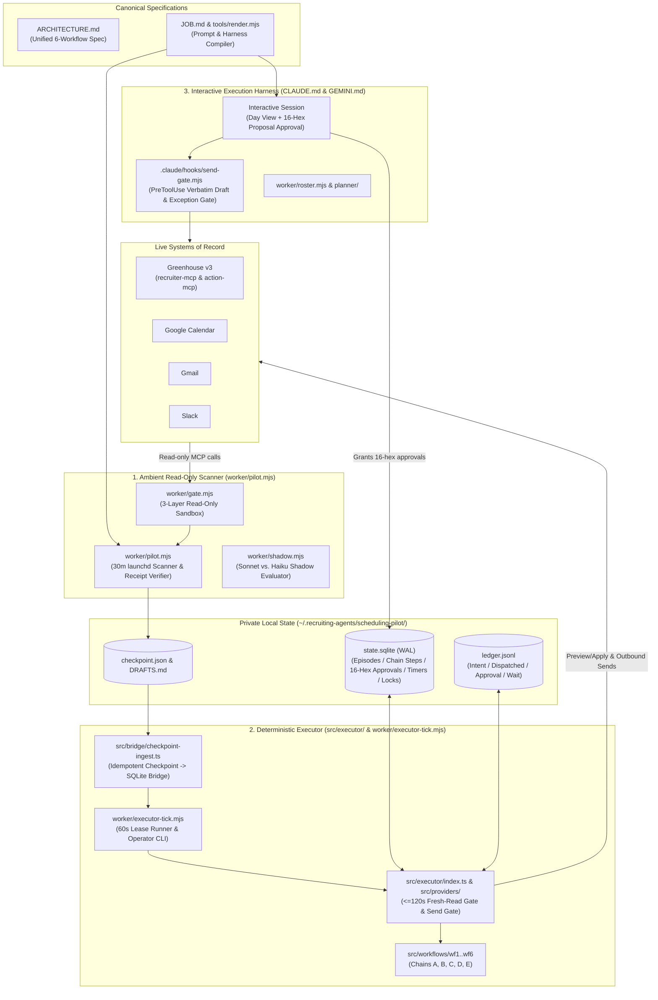

# recruiting-ops-agent

An autonomous, human-in-the-loop **Recruiting Operations Agent** to run full-lifecycle technical recruiting operations and interview coordination across **Greenhouse**, **Google Calendar**, **Gmail**, **Slack**, **Calendly**, and **Granola**.

Designed for a recruiting organization operating without dedicated recruiting coordinators, `recruiting-ops-agent` unifies **six core recruiting workflows**—from Calendly candidate intake and Granola screen scorecard submission to hiring-manager Slack signal routing, deliberated candidate rejections, cross-requisition transfers/grooming, and full 10-step interview scheduling—while running entirely under the recruiter's own identity via Model Context Protocol (MCP) connectors and `GreenhouseActionService` (`greenhouse-mcp`).

---

## Six Recruiting Operations Workflows ([`ARCHITECTURE.md`](ARCHITECTURE.md))

| Workflow | Module | Trigger & Lifecycle |
| :--- | :--- | :--- |
| **Workflow 1: Candidate Booking Intake** | [`src/workflows/wf1-intake.ts`](src/workflows/wf1-intake.ts) | Correlates Calendly, Gmail, and Google Calendar booking signals via `booking_fingerprint`; enforces Ruling 1 (`AWAITING_JOB_MAPPING` hold + `starts_at - 2h` urgent Slack DM); executes **Chain C** two-step Greenhouse upload (`candidate_create` → `application_create` / `prospect_convert` / forward-only `application_stage_move` → out-of-band `attachment_create` → `interview_create` → `candidate_note_create`). |
| **Workflow 2: Granola Screen → Scorecard & Coupled Decision** | [`src/workflows/wf2-scorecard.ts`](src/workflows/wf2-scorecard.ts) | Enforces strict Sam Vangelos rating authority, speaker-turn verification, and verbatim quote-grounding; adapts `systems-admin` drafts to `scorecard_submit`; executes resumable **Chain D** (Step 1 `scorecard_submit` + Coupled Step 2: stage move to `Hiring Manager Review` + `#field-engineering-hiring` post on `yes`/`strong_yes`, or WF4 deliberated rejection timer on `no`/`strong_no`). |
| **Workflow 3: Slack HM Positive Signal → Stage Advance & Outreach** | [`src/workflows/wf3-hm-signal.ts`](src/workflows/wf3-hm-signal.ts) | Enforces single-consumption lock (`wf3_hm_signals`) per `(application_id, stage_id)` and Ruling 3 multi-candidate slate disambiguation; verifies reaction-removal/HM-override on $\le 120\text{s}$ fresh reads; routes dynamically to `Turing Assessment` (`12579939004`) or `Manager / Tech Screen` (`12579940004`) with double-email prevention. |
| **Workflow 4: Deliberated Candidate Rejection** | [`src/workflows/wf4-rejection.ts`](src/workflows/wf4-rejection.ts) | Enforces stage-scoped negative scorecard evaluation, mixed-panel `CONFLICT_HOLD` state machine, Ruling 2 candidate-local deliberation timers (`[60, 180]` min clamped to `08:30–17:30` Mon–Fri candidate local time), and **Chain B** single-mutation Greenhouse rejection (`application_reject`). |
| **Workflow 5: Cross-Job Transfers & Grooming (5A / 5B / 5C)** | [`src/workflows/wf5-grooming.ts`](src/workflows/wf5-grooming.ts) | **5A (Chain E):** Cross-requisition `transfer` (`application_job_transfer`) vs `fork` (`application_create` + `attachment_create`). **5B:** Forward-only stage-drift repair on `scheduled`/`awaiting_feedback` interviews in later stages. **5C:** Missing recruiter/coordinator assignment via `application_assignment_change`. |
| **Workflow 6: 10-Step Interview Scheduling Lifecycle** | [`src/workflows/wf6-scheduling.ts`](src/workflows/wf6-scheduling.ts) | Full **Chain A** coordinator lifecycle: availability outreach, multi-timezone calendar intersection (`planner/`), silent calendar hold + Greenhouse `interview_create` with automatic compensation on failure, `+12h`/`+24h` working-hours interviewer RSVP chases, end-to-end candidate confirmation (Greenhouse confirmation email with Google Meet + separate candidate-only `"Interview with Turing"` Calendar invite + Activity Feed `EMAIL` note), `+24h` day-before candidate reminder, reschedule/cancel handling, and `+2h`/`+24h` scorecard chases. |

---

## Architecture Overview

The system splits recruiting operations into **three coordinated planes** that share [`ARCHITECTURE.md`](ARCHITECTURE.md) and [`JOB.md`](JOB.md), backed by a WAL-mode SQLite coordinator store ([`src/store/sqlite.ts`](src/store/sqlite.ts)), an append-only JSON Lines ledger ([`LEDGER.md`](LEDGER.md)), and a deterministic TypeScript slot/guard engine ([`planner/`](planner/)):



### 1. Ambient Read-Only Worker ([`worker/pilot.mjs`](worker/pilot.mjs))
Runs every 30 minutes via macOS `launchd`, sweeps Gmail, Google Calendar, Slack, and Greenhouse under a 3-layer read-only sandbox ([`worker/gate.mjs`](worker/gate.mjs)), verifies that every model claim is backed by actual paginated tool-call receipts, and writes verified proposals to `~/.recruiting-agents/scheduling-pilot/checkpoint.json` and `DRAFTS.md`.

### 2. Deterministic Executor & WAL SQLite Store ([`src/executor/index.ts`](src/executor/index.ts), [`src/store/sqlite.ts`](src/store/sqlite.ts), [`src/bridge/checkpoint-ingest.ts`](src/bridge/checkpoint-ingest.ts), [`src/providers/live-providers.ts`](src/providers/live-providers.ts), [`worker/executor-tick.mjs`](worker/executor-tick.mjs))
Runs every 60 seconds under a single-writer SQLite lease (`writer_lease` with dead-PID takeover), idempotently ingesting verified `checkpoint.json` episodes into `state.sqlite`, firing due working-hours/deliberation timers, and executing human-approved 16-hex `proposal_hash` chains across Workflows 1–6. Every step enforces a fail-closed $\le 120\text{s}$ pre-dispatch fresh-read gate (`verifyFreshState`), two-phase `intent` $\rightarrow$ `succeeded` journaling in both `state.sqlite` and `ledger.jsonl`, resumable `GreenhouseActionService` composite steps (`PARTIAL_APPLIED`), and in-process send-gate verification (`verifyInProcessSendGate`). Also exposes an operator CLI (`list-proposals`, `approve`, `decline`, `resolve-job`, `resolve-conflict`, `status`, `tick --dry-run`).

### 3. Interactive Execution Harness ([`CLAUDE.md`](CLAUDE.md), [`GEMINI.md`](GEMINI.md), [`.claude/hooks/send-gate.mjs`](.claude/hooks/send-gate.mjs))
Starting a Claude Code or Gemini / Antigravity session in this repository boots directly into recruiting operations mode, protected by a fail-closed `PreToolUse` outbound send gate ([`.claude/hooks/send-gate.mjs`](.claude/hooks/send-gate.mjs), wired via [`.claude/settings.json`](.claude/settings.json) and [`.agents/hooks.json`](.agents/hooks.json)) that blocks any unapproved outbound email/Slack message unless its exact recipient, subject, and body were shown verbatim to Sam prior to his latest turn (or carry a fresh $<15\text{m}$ ledger exception token / standard Greenhouse confirmation template `4151798004` with Google Meet).

---

## Key Engineering Highlights

### Single-Source-of-Truth Prompt Compilation ([`JOB.md`](JOB.md) → [`tools/render.mjs`](tools/render.mjs))
Rather than maintaining separate prompt files that inevitably drift, [`JOB.md`](JOB.md) is the canonical specification for the 10 scheduling steps, scope boundaries, and approval rules. [`tools/render.mjs`](tools/render.mjs) compiles `JOB.md` into [`worker/prompt.md`](worker/prompt.md) and the operating sections of [`CLAUDE.md`](CLAUDE.md) and [`GEMINI.md`](GEMINI.md). The test suite ([`worker/ledger.test.mjs`](worker/ledger.test.mjs)) enforces freshness (`node tools/render.mjs --check`) on every run.

### Three-Layer Read-Only Sandboxing ([`worker/gate.mjs`](worker/gate.mjs))
The ambient background scanner cannot send messages, create drafts, or mutate calendars or candidate records across three independent layers:
1. **Explicit CLI allowlist (`--allowedTools`)**: Restricts tool discovery to 14 specific MCP read tools.
2. **Verb-glob denylist (`--disallowedTools`)**: Blocks built-in shell/file/browser tools and 38 mutation verb patterns (`mcp__*__send*`, `mcp__*__create*`, `mcp__*__update*`, etc.) even if granted in user settings.
3. **Fail-closed `PreToolUse` hook ([`worker/gate.mjs`](worker/gate.mjs))**: Inspects every tool invocation at runtime with `"onFailure": "block"`, denying any tool outside the read allowlist and enforcing requisition scoping (`job_id`) on Greenhouse queries.

### Deterministic Receipt Verification ([`worker/pilot.mjs`](worker/pilot.mjs))
An LLM's claim that it checked all four systems is never trusted on faith. Before accepting a background scan, `pilot.mjs` parses the raw JSONL execution stream and independently verifies:
- Actual successful tool-call receipts exist from all four services (Gmail, Calendar, Slack, Greenhouse).
- Pagination tokens (Gmail `nextPageToken`, Slack prose cursors, Greenhouse offset slices) were followed to exhaustion.
- Every thread returned by a Gmail search was opened with `FULL_CONTENT` (or recovered via per-message `get_message` reads if clipped)—snippets or metadata-only reads fail verification.
- Every fact and proposed action cites a verified tool receipt from that run.

### Cross-System Roster Join & Discrepancy Detection ([`worker/roster.mjs`](worker/roster.mjs))
`roster.mjs` joins active Greenhouse applications, scheduled interviews, and candidate profiles with Google Calendar events across three confidence tiers:
1. `interview.external_event_id === calendarEvent.id`
2. `application_id` parsed from the Greenhouse interview guide URL in the calendar description
3. Candidate email match against event attendees or Calendly invitee metadata

It automatically flags five cross-system discrepancy types (`time_mismatch`, `event_no_greenhouse_row`, `screen_no_application`, `to_be_scheduled_no_event`, and `complete_needs_decision`).

### Two-Phase Idempotent Ledger ([`LEDGER.md`](LEDGER.md), [`worker/ledger.mjs`](worker/ledger.mjs))
Because Gmail and Slack lack native client-supplied idempotency keys for all operations, outward session steps use two-phase persistence in `ledger.jsonl`:
1. Append an `action` record with `status: "intent"` and a deterministic `idempotency_key` **before** calling the provider.
2. Append `status: "dispatched"` with the returned `provider_id` upon completion.

`dedupe()` folds records by `idempotency_key` so interrupted sends remain visible on restart while completed actions and declined approvals (`kind: "approval"`, `decision: "declined"`) deterministically suppress duplicate worker proposals.

### Deterministic Slot Planner & 7-Rule Pre-Send Guard ([`planner/`](planner/))
The pure, zero-dependency TypeScript package in [`planner/`](planner/) handles logic that an LLM should never improvise:
- **IANA Timezone & DST Math ([`planner/src/time.ts`](planner/src/time.ts))**: Normalizes Greenhouse's legacy timezone labels (e.g., `"Eastern Time (US & Canada)"`, `"Asia/Calcutta"`) to canonical IANA zones and performs all comparisons in epoch milliseconds via `Intl.DateTimeFormat`, eliminating wall-clock bugs during the late-October US/Europe daylight-saving transition gap.
- **Slot Intersection ([`planner/src/slots.ts`](planner/src/slots.ts))**: Intersects candidate windows with interviewer and recruiter free/busy blocks, enforcing local working hours, 15-minute buffers, 30-minute wall-clock boundaries, daily interview caps, and fail-closed error handling.
- **Pre-Dispatch Guard ([`planner/src/guard.ts`](planner/src/guard.ts))**: Validates outgoing payloads against 7 deterministic rules (`recipients`, `no-zoom`, allowlisted `links`, calendar-verified `confirmed-times`, cross-candidate name leak prevention `other-candidates`, unrendered `[Bracket]` `placeholders`, and `word-cap`).

### Live Shadow Model Evaluation ([`worker/shadow.mjs`](worker/shadow.mjs))
To evaluate whether a faster, lower-cost model (`claude-haiku-5-5`) can match `claude-sonnet-5-5` on production scheduling traffic, `shadow.mjs` runs parallel read-only scans in an isolated data directory, pairs each shadow run with the nearest live run, and scores verification rate, per-source coverage, subject-normalized episode recall (`app:<id>`, `thread:<id>`), draft word-count diffs, turn count, latency, and cost ratio in `SHADOW.md`.

---

## Sanitized Runtime Examples

All runtime state and candidate data live outside Git in `~/.recruiting-agents/scheduling-pilot/` (`0700` directory, `0600` files). Below are sanitized examples using fictional candidates (`Priya Ramos`, `Alex Rivera`) and a fictional interviewer (`Dana Okafor`).

<details>
<summary><strong>1. Interactive Session Boot — Day View & Candidates in Play</strong></summary>

```markdown
### Day View — Today (Pacific)
1. **10:00–10:30 PDT** | **Alex Rivera** — Recruiter Screen (Calendly)
   - Calendar: `cal-calendly-1` | Recruiter: Accepted | Candidate: Confirmed
2. **12:00–12:45 PDT** | **Priya Ramos** — Technical Screen (`app:7000000002`, Step 7)
   - Calendar: `cal-gh-1` | Interviewer (`dana.okafor@turing.com`): `needsAction` (sent 13.5 working hours ago) | Candidate: Unconfirmed (awaiting interviewer acceptance)

### Roster Discrepancies
- `to_be_scheduled_no_event`: Application `7000000004` (HM Screen) is marked `to_be_scheduled` in Greenhouse with no corresponding calendar hold.

### Unreviewed Worker Proposals (from `DRAFTS.md`)
- **[1] `7000000002:screening-round:interviewer-acceptance-nudge`** (Slack → `@Dana Okafor`)
  - **Action**: Send 12-hour working-time interviewer acceptance check in Slack.
  - **Draft**: `"Hi <@U0123DANA>, following up on the calendar invite for Priya Ramos's technical screen today at 12:00 pm Pacific -- can you make that time?"`
```
</details>

<details>
<summary><strong>2. Shared Ledger Entries (<code>ledger.jsonl</code>)</strong></summary>

```jsonl
{"kind":"approval","idempotency_key":"apr:7000000002:screening-round:interviewer-acceptance-nudge","at":"2026-10-16T18:00:00.000Z","actor":"sam","episode_id":"7000000002:screening-round","action_key":"7000000002:screening-round:interviewer-acceptance-nudge","decision":"approved"}
{"kind":"action","idempotency_key":"act:7000000002:screening-round:interviewer-acceptance-nudge:1","at":"2026-10-16T18:00:02.000Z","actor":"sam","episode_id":"7000000002:screening-round","action_key":"7000000002:screening-round:interviewer-acceptance-nudge","service":"slack","status":"intent","provider_id":null,"summary":"Send 12-hour interviewer acceptance check on Slack"}
{"kind":"action","idempotency_key":"act:7000000002:screening-round:interviewer-acceptance-nudge:1","at":"2026-10-16T18:00:05.000Z","actor":"sam","episode_id":"7000000002:screening-round","action_key":"7000000002:screening-round:interviewer-acceptance-nudge","service":"slack","status":"dispatched","provider_id":"1792191600.000100","summary":"Sent 12-hour interviewer acceptance check on Slack"}
```
</details>

<details>
<summary><strong>3. Shadow Model Evaluation Summary (<code>SHADOW.md</code>)</strong></summary>

```markdown
# Shadow comparison

- Pairs: 8 (8 with a live run, 8 where both verified)
- Shadow verified: 8/8
- Episode mismatches: 2 (only in live 0, only in shadow 0, status differs 0)
- Subject mismatches: 0 (only in live 0, only in shadow 0, status differs 0)
- Action mismatches: 1 (only in live 0, only in shadow 1, shared 14, draft text differs on 3)
- Cost: shadow $0.42 vs live $1.84 (ratio 0.23)

| Shadow start (Pacific) | Live start (Pacific) | Shadow verified | Coverage L / S | Episodes only L / only S / status | Subjects only L / only S / status | Actions only L / only S / shared (diff) | Unknowns L / S | Cost S / L (ratio) | Duration S / L (ratio) | Turns S / L |
|---|---|---|---|---|---|---|---|---|---|---|
| 2026-10-18 15:50 | 2026-10-18 15:30 | yes | 4/4 / 4/4 | 0 / 0 / 0 | 0 / 0 / 0 | 0 / 0 / 2 (0) | 0 / 0 | $0.05 / $0.23 (0.22) | 41s / 68s (0.60) | 14 / 16 |
```
</details>

---

## Repository Layout

- [`ARCHITECTURE.md`](ARCHITECTURE.md) — Canonical specification for the unified 6-workflow Recruiting Operations Agent, `state.sqlite` schema, deterministic executor chains (Chains A–E), and security boundaries.
- [`JOB.md`](JOB.md) — Canonical 10-step specification of the interview scheduling workflow, scope boundaries, and human-in-the-loop approval rules.
- [`LEDGER.md`](LEDGER.md) — Schema and idempotency contract for the shared append-only ledger (`ledger.jsonl`).
- [`CLAUDE.md`](CLAUDE.md) & [`GEMINI.md`](GEMINI.md) — Interactive Claude Code and Gemini / Antigravity session harnesses (operating rules generated from [`JOB.md`](JOB.md)).
- [`.claude/hooks/send-gate.mjs`](.claude/hooks/send-gate.mjs) — Fail-closed `PreToolUse` hook gating all outbound Gmail/Slack sends and Greenhouse mutations across both harnesses ([`.claude/settings.json`](.claude/settings.json) and [`.agents/hooks.json`](.agents/hooks.json)).
- [`src/`](src/) — Deterministic Recruiting Operations Engine:
  - [`src/store/sqlite.ts`](src/store/sqlite.ts) — WAL-mode `SqliteCoordinatorStore` (`writer_lease`, `episodes`, `chain_steps`, 16-hex `approvals`, `timers`, `wf4_conflict_holds`, `wf3_hm_signals`).
  - [`src/executor/index.ts`](src/executor/index.ts) — `DeterministicExecutor` ($\le 120\text{s}$ `verifyFreshState` gate, `executeGreenhouseStep` composite loop, `verifyInProcessSendGate`, single-writer tick runner).
  - [`src/bridge/checkpoint-ingest.ts`](src/bridge/checkpoint-ingest.ts) — Idempotent `checkpoint.json` $\rightarrow$ `state.sqlite` ingestion bridge (`ingestCheckpointToSqlite`).
  - [`src/providers/live-providers.ts`](src/providers/live-providers.ts) — Live Greenhouse v3, Gmail, Google Calendar, and Slack provider adapters and `FreshReadFetcher`.
  - [`src/utils/timezone.ts`](src/utils/timezone.ts) — `RAILS_TO_IANA_TZ`, US holiday-aware `addWorkingHours`, and Ruling 2 deliberation window calculators.
  - [`src/workflows/`](src/workflows/) — Workflows 1–6 ([`wf1-intake.ts`](src/workflows/wf1-intake.ts), [`wf2-scorecard.ts`](src/workflows/wf2-scorecard.ts), [`wf3-hm-signal.ts`](src/workflows/wf3-hm-signal.ts), [`wf4-rejection.ts`](src/workflows/wf4-rejection.ts), [`wf5-grooming.ts`](src/workflows/wf5-grooming.ts), [`wf6-scheduling.ts`](src/workflows/wf6-scheduling.ts)).
- [`test/`](test/) — End-to-end integration, runtime, and adversarial regression suites ([`test/wp3-wp4.test.ts`](test/wp3-wp4.test.ts), [`test/wp5-wp6.test.ts`](test/wp5-wp6.test.ts), [`test/chunk4-runtime.test.ts`](test/chunk4-runtime.test.ts)).
- [`worker/`](worker/) — Ambient read-only runner ([`pilot.mjs`](worker/pilot.mjs)), 60s deterministic executor tick & operator CLI ([`executor-tick.mjs`](worker/executor-tick.mjs)), `PreToolUse` read gate ([`gate.mjs`](worker/gate.mjs)), Greenhouse + Calendar roster builder ([`roster.mjs`](worker/roster.mjs)), shared ledger module ([`ledger.mjs`](worker/ledger.mjs)), multi-model shadow evaluator ([`shadow.mjs`](worker/shadow.mjs)), and test suite (`*.test.mjs`). See [`worker/README.md`](worker/README.md).
- [`planner/`](planner/) — Pure, zero-dependency TypeScript package for IANA timezone normalization, free/busy slot intersection, strict template rendering, and 7-rule pre-send message guarding. See [`planner/README.md`](planner/README.md) and [`planner/WORKFLOW.md`](planner/WORKFLOW.md).
- [`tools/`](tools/) — Prompt/harness compiler ([`tools/render.mjs`](tools/render.mjs)) and frozen runtime deployment installer ([`tools/deploy-runtime.mjs`](tools/deploy-runtime.mjs)).
- [`launchd/`](launchd/) — macOS LaunchAgent plist templates for `.worker` (every 30m), `.executor-tick` (every 60s), `.health` (every 5m), and `.shadow-haiku` (8x/day).
- [`docs/reviews/`](docs/reviews/) — Architecture and adversarial review briefs.

---

## Running Tests & Verification Gate

All tests run offline against hermetic fixtures and mock CLI streams (zero live network calls or credentials required).

1. **Verify prompt compilation freshness from [`JOB.md`](JOB.md):**

```sh
node tools/render.mjs          # Regenerate worker/prompt.md, CLAUDE.md, and GEMINI.md
node tools/render.mjs --check  # Fail if generated files are stale
```

2. **Run the full verification and test suite (175 tests across `worker/`, `send-gate`, `test/`, plus `planner/`):**

```sh
node tools/render.mjs --check && node --test worker/*.test.mjs .claude/hooks/send-gate.test.mjs test/wp3-wp4.test.ts test/wp5-wp6.test.ts test/chunk4-runtime.test.ts
npm --prefix planner test && npm --prefix planner run typecheck
```

---

## Local Deployment & Cutover

In production on macOS, the four `launchd` jobs (`com.recruiting-agents.scheduling-pilot.worker`, `.executor-tick`, `.health`, `.shadow-haiku`) execute an isolated frozen copy in `~/.recruiting-agents/scheduling-pilot/app/` (`0700` directory, `0600` files) installed via [`tools/deploy-runtime.mjs`](tools/deploy-runtime.mjs):

```sh
node tools/deploy-runtime.mjs
launchctl kickstart gui/$(id -u)/com.recruiting-agents.scheduling-pilot.worker
node ~/.recruiting-agents/scheduling-pilot/app/pilot.mjs status
node ~/.recruiting-agents/scheduling-pilot/app/worker/executor-tick.mjs status
```
